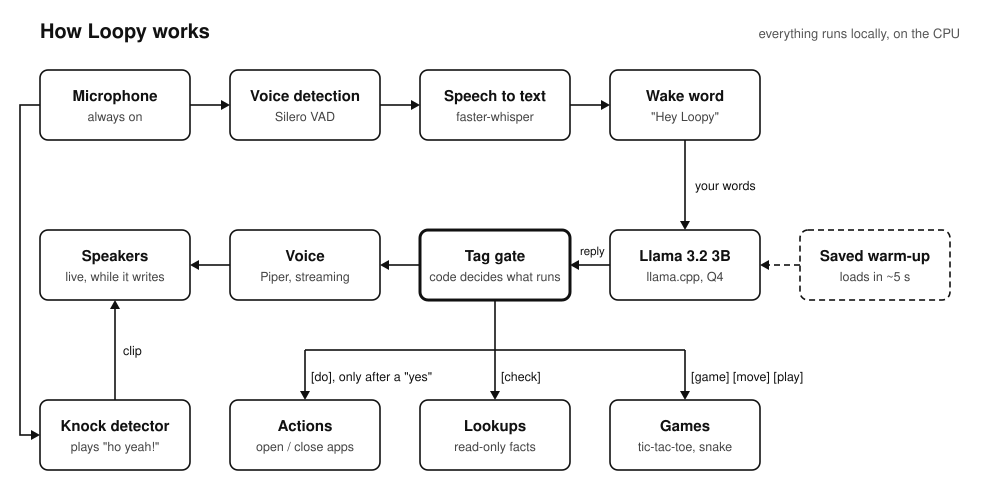

# Loopy

[](https://github.com/ravishankardas/loopy/actions/workflows/ci.yml)


A voice assistant that lives on your desktop as a little paperclip. Say **"Hey Loopy"** and talk to it. It runs **entirely on your own computer**: no cloud, no API keys, no GPU.

## Features

- **Talks like a person:** Llama 3.2 3B, with replies spoken while they're still being written.
- **Always asks before acting:** enforced in code, not just in the prompt.
- **Looks things up:** time, date, battery, CPU/memory, disk space (read-only, guarded by tests).
- **Plays games:** tic-tac-toe against a trash-talking Loopy, or snake while it cheers you on.
- **Reacts to knocks:** hit the laptop and it shouts "Can I get a ho yeah?!"
- **Starts in ~5 s:** the model's warm-up is saved to disk (it used to take ~100 s).

## Install

```bash
pip install git+https://github.com/ravishankardas/loopy --extra-index-url https://abetlen.github.io/llama-cpp-python/whl/cpu
loopy setup     # once: downloads the models (~2.2 GB) and prepares them (~2 min)
loopy
```

Needs Python 3.10+, about 8 GB of RAM, a mic and speakers. Built on Windows 11; on Ubuntu, also run `sudo apt install libxcb-cursor0`.

## Usage

Say "Hey Loopy", then just talk. Drag Loopy with the mouse; right-click it for typing, voices, sleep and quit.

| Command | What it does |
|---|---|
| `loopy` | Start Loopy |
| `loopy ttt` / `loopy snake` | Start straight into a game |
| `loopy chat` | Chat by typing |
| `loopy setup` / `loopy rebuild` | Download models / redo the saved warm-up |
| `loopy voices`, `say`, `hear`, `knock-test` | Test the voice, mic and knock detection |

## How it works



Every reply from the model starts with a tag (`[ask: open chrome]`, `[do: ...]`, `[check: battery]`, `[play: 5]`...). The **tag gate** reads it before anything is spoken: a `[do]` only runs if you said yes to that exact question, lookups can't change anything, and game moves are checked by the code.

On a 4-core laptop CPU: speech recognition 1–2 s, Loopy starts answering 1–2 s later, about 3 GB of RAM.

## Development

```bash
pip install -e ".[dev]" --extra-index-url https://abetlen.github.io/llama-cpp-python/whl/cpu
python -m unittest discover tests     # 172 tests with a fake model, a few seconds
ruff check src tests && mypy
```

CI runs all of this on Windows and Ubuntu on every push. Set `LOOPY_MODEL_TESTS=1` to also test against the real model.

## Credits

[Llama 3.2](https://www.llama.com/) (Meta) via [llama.cpp](https://github.com/ggml-org/llama.cpp) · [faster-whisper](https://github.com/SYSTRAN/faster-whisper) · [Silero VAD](https://github.com/snakers4/silero-vad) · [Piper](https://github.com/OHF-Voice/piper1-gpl) · [PySide6](https://doc.qt.io/qtforpython/). Each has its own license.
